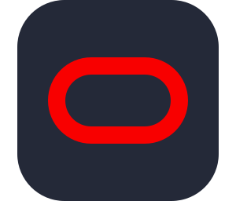
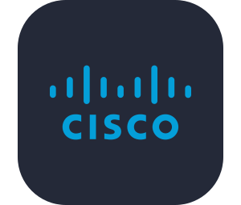
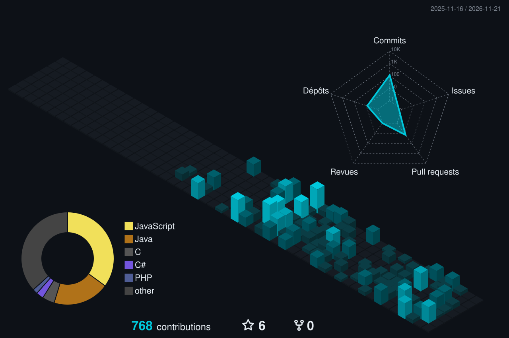

  <b>Étudiant en 2e année de BUT Informatique à Caen</b> · Java, web et bases de données 
  Je cherche un <b>stage à partir d'avril 2027</b>, à Caen ou dans les environs.

  
  
  

## À propos

Je fais surtout du **développement** : Java, C, web et bases de données en cours, et des projets perso pour aller plus loin que ce qu'on voit en classe.

À côté, la **cybersécurité** m'intéresse beaucoup : comprendre comment on attaque un système et comment on le protège. Je m'y forme sur [TryHackMe](https://tryhackme.com/p/ORZEX).

## Projets

### Projets perso

| Projet | Ce que ça fait | Technos |
| --- | --- | --- |
| **[MacTidy](https://github.com/EnzoBuchaillat/MacTidy)** *(en cours)* | Repère les fichiers lourds et inutilisés depuis longtemps pour faire le tri sur son Mac |  |
| **[Enquete](https://github.com/EnzoBuchaillat/Enquete)** *(en cours)* | Un petit jeu d'enquête en console, pour apprendre le C# : on explore un manoir et on interroge suspects et témoins |  |
| **[Dropresell](https://dropresell.com)** | Une application web pour les vendeurs Vinted, construite avec l'aide de l'IA, de l'idée à la mise en ligne |  |

### Projets d'école

| Projet | Ce que ça fait | Technos |
| --- | --- | --- |
| **[animeRequester](https://github.com/EnzoBuchaillat/animeRequester)** | Recherche d'animés via une API, réalisée en équipe de 3 · [démo](https://enzobuchaillat.github.io/animeRequester/) |   |
| **[minichat](https://github.com/EnzoBuchaillat/minichat)** | Un petit chat en ligne, avec requêtes préparées et protection contre les failles XSS |   |
| **[js-memory-game](https://github.com/EnzoBuchaillat/js-memory-game)** | Un jeu de Memory sans framework · [démo](https://enzobuchaillat.github.io/js-memory-game/) |  |

Mes travaux de cours sont aussi en ligne : [Coursework](https://github.com/EnzoBuchaillat/Coursework) (1re année, C, Java et SQL) et [CourseJS](https://github.com/EnzoBuchaillat/CourseJS) (HTML, CSS et JavaScript).

## Domaines

| Domaine | Où j'en suis | Ce que je veux apprendre |
| --- | --- | --- |
| **Java** | Vu en cours, et MacTidy en projet perso | Le développement back-end avec Spring |
| **Web** | HTML, CSS et JavaScript natifs, appels d'API avec `fetch`, PHP avec sessions | Un framework front moderne |
| **Bases de données** | SQL, Oracle, et MySQL avec PDO et requêtes préparées | Concevoir un schéma propre de bout en bout |
| **C** | La programmation en C vue en cours | La mémoire, ce qui se passe sous le capot |
| **Linux et réseau** | Bash, scripts, modèle OSI, TCP/IP, Packet Tracer | L'administration système |
| **Cybersécurité** *(centre d'intérêt)* | Je m'y forme sur TryHackMe | Les failles web classiques (OWASP Top 10) et comment s'en protéger |

## Compétences

  
  
  
  

Des notions en

  

## Activité

  

  Une question, un projet ou une opportunité ? Écris-moi par <a href="mailto:buchaillatenzo@gmail.com">e-mail</a> ou sur <a href="https://www.linkedin.com/in/enzo-buchaillat-9472513a1/">LinkedIn</a>.

