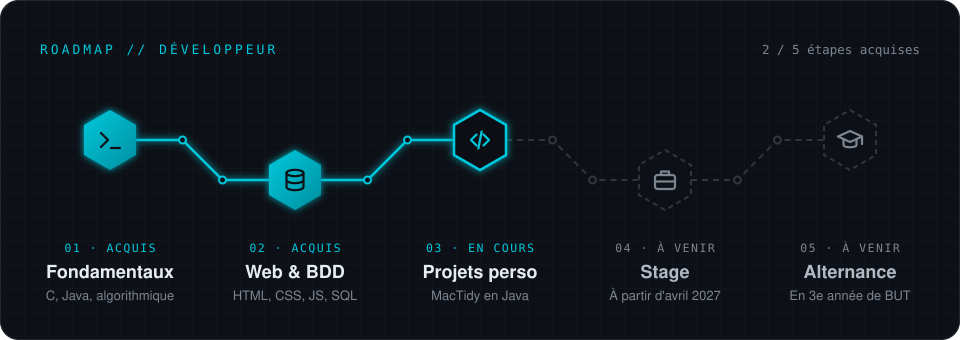
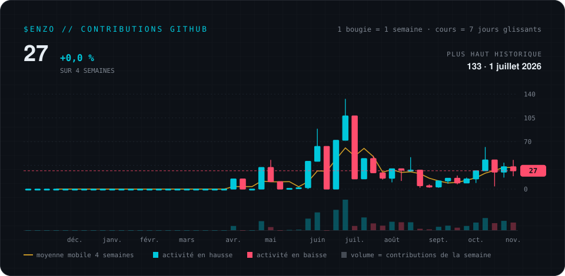
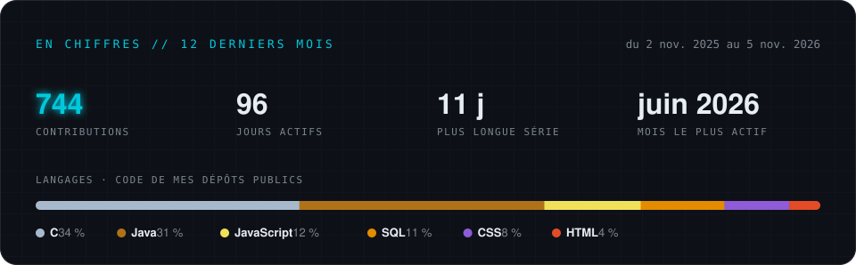

  
  
  

## À propos

Je suis en 2e année de BUT Informatique à l'IUT de Caen, et je fais surtout du **développement** : Java, C, web et bases de données en cours, et des projets perso pour aller plus loin que ce qu'on voit en classe.

À côté, la **cybersécurité** m'intéresse beaucoup : comprendre comment on attaque un système et comment on le protège. Je m'y forme sur [TryHackMe](https://tryhackme.com/p/ORZEX).

## Feuille de route

  

## Domaines

| Domaine | Où j'en suis | Ce que je veux apprendre |
| --- | --- | --- |
| **Java** | Vu en cours, et MacTidy en projet perso | Le développement back-end avec Spring |
| **Web** | HTML, CSS et JavaScript natifs, PHP en projet d'équipe | Un framework front moderne |
| **Bases de données** | SQL, Oracle en projet d'équipe | Concevoir un schéma propre de bout en bout |
| **C** | La programmation en C vue en cours | La mémoire, ce qui se passe sous le capot |
| **Linux et réseau** | Bash, scripts, modèle OSI, TCP/IP, Packet Tracer | L'administration système |
| **Cybersécurité** *(centre d'intérêt)* | Je m'y forme sur TryHackMe | Les failles web classiques (OWASP Top 10) et comment s'en protéger |

## En ce moment

- Je code **[MacTidy](https://github.com/EnzoBuchaillat/MacTidy)**, un outil en Java qui aide à faire le tri dans les fichiers de son Mac
- Je cherche un stage pour avril 2027, à Caen ou dans les environs

## Projets

### Projets perso

| Projet | Ce que ça fait | Technos |
| --- | --- | --- |
| **[MacTidy](https://github.com/EnzoBuchaillat/MacTidy)** *(en cours)* | Repère dans un dossier les fichiers lourds et inutilisés depuis longtemps, pour faire le tri sur son Mac. Je le code moi-même, étape par étape, pour progresser en Java en dehors des cours. |  |
| **[Dropresell](https://dropresell.com)** | Une application web pour les vendeurs Vinted, construite avec l'aide de l'IA. Elle m'a surtout appris à mener un projet de bout en bout, de l'idée à la mise en ligne. |  |

### Projets d'école

| Projet | Ce que ça fait | Technos |
| --- | --- | --- |
| **[Viking Transport](https://github.com/EnzoBuchaillat/VikingTransport-sae-2.4-5-6)** | Site de réservation de trajets réalisé en équipe de 7 pour une SAÉ, avec une recherche d'itinéraire par l'algorithme de Dijkstra |   |
| **[js-memory-game](https://github.com/EnzoBuchaillat/js-memory-game)** | Un jeu de Memory sans framework ([démo en ligne](https://enzobuchaillat.github.io/js-memory-game/)) |  |
| **[Coursework](https://github.com/EnzoBuchaillat/Coursework)** | Mes travaux de première année |    |
| **[CourseJS](https://github.com/EnzoBuchaillat/CourseJS)** | Mes exercices de développement web |    |

## Compétences

  
  

Des notions en

  

  
  
  

## Activité

  

  

## En dehors du code

  
  

## Me contacter

Une question, un projet ou une opportunité ? Écris-moi ou retrouve-moi sur LinkedIn.

  
  
  

