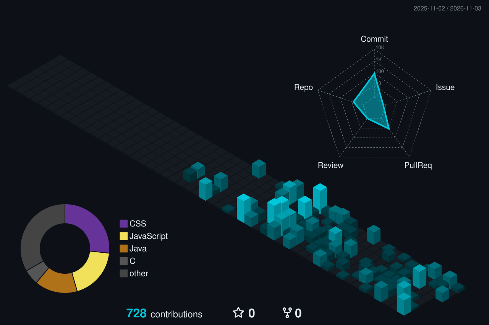

  
  
  

## À propos

Je suis en 2e année de BUT Informatique à l'IUT de Caen. J'aime comprendre comment fonctionnent les systèmes de l'intérieur, et surtout comment on les attaque et comment on les protège : la **cybersécurité** est le domaine qui m'attire le plus. Je m'y forme en parallèle de mes cours, notamment sur [TryHackMe](https://tryhackme.com/p/ORZEX).

En dehors des cours, je construis aussi des projets perso pour pratiquer et apprendre des choses que je ne vois pas encore en classe.

## Feuille de route

  

## Domaines

| Domaine | Où j'en suis | Ce que je veux apprendre |
| --- | --- | --- |
| **Sécurité web** | Je m'y forme sur TryHackMe | Authentification, contrôle d'accès, injections, gestion des secrets (OWASP Top 10) |
| **Linux** | Les bases : Bash, scripts, ligne de commande | L'administration système |
| **Réseau** | Modèle OSI, TCP/IP, adressage IP, simulations sur Cisco Packet Tracer | Comment on attaque et on défend un réseau |
| **Bas niveau** | La programmation en C vue en cours | La mémoire, ce qui se passe sous le capot |

## En ce moment

- Je code **[MacTidy](https://github.com/EnzoBuchaillat/MacTidy)**, un outil en Java qui aide à faire le tri dans les fichiers de son Mac
- Je cherche un stage pour avril 2027, à Caen ou dans les environs

## Projets

### Projets perso

| Projet | Ce que ça fait | Technos |
| --- | --- | --- |
| **[MacTidy](https://github.com/EnzoBuchaillat/MacTidy)** *(en cours)* | Repère dans un dossier les fichiers lourds et inutilisés depuis longtemps, pour faire le tri sur son Mac. Je le code moi-même, étape par étape, pour progresser en Java en dehors des cours. |  |
| **[Dropresell](https://dropresell.com)** | Une application web pour les vendeurs Vinted, construite avec l'aide de l'IA. Elle m'a surtout appris à mener un projet de bout en bout, de l'idée à la mise en ligne. |  |

### Projets d'école

| Projet | Ce que ça fait | Technos |
| --- | --- | --- |
| **[Viking Transport](https://github.com/EnzoBuchaillat/VikingTransport-sae-2.4-5-6)** | Site de réservation de trajets réalisé en équipe de 7 pour une SAÉ, avec une recherche d'itinéraire par l'algorithme de Dijkstra |   |
| **[js-memory-game](https://github.com/EnzoBuchaillat/js-memory-game)** | Un jeu de Memory sans framework ([démo en ligne](https://enzobuchaillat.github.io/js-memory-game/)) |  |
| **[Coursework](https://github.com/EnzoBuchaillat/Coursework)** | Mes travaux de première année |    |
| **[CourseJS](https://github.com/EnzoBuchaillat/CourseJS)** | Mes exercices de développement web |    |

## Compétences

  
  

Des notions en

  

  
  
  

## Activité

  

  

## En dehors du code

  
  

## Me contacter

Une question, un projet ou une opportunité ? Écris-moi ou retrouve-moi sur LinkedIn.

  
  
  

